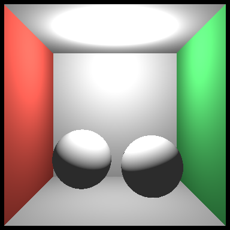
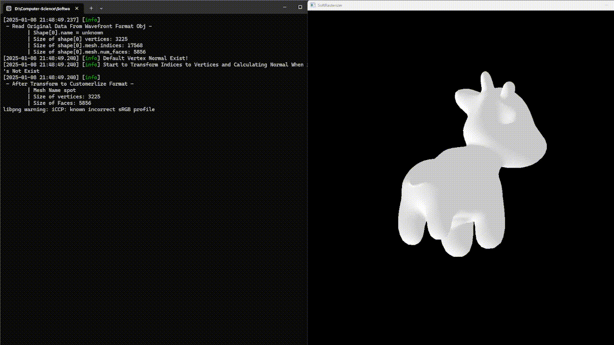
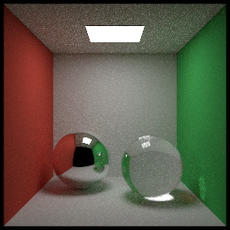
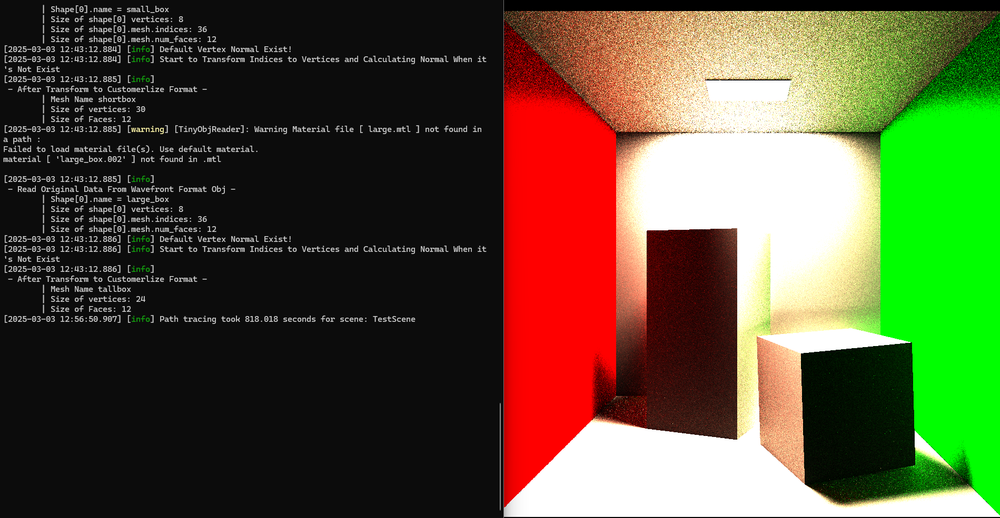

# Software-Rasterizer

## 0x00 Description

**SoftRasterizer** is a C++17, CPU-based 3D rendering pipeline for traditional triangle rasterization and Monte Carlo path tracing. Both renderers share world-space objects, materials and camera settings. The rasterizer supports scalar and portable SIMD processing; the path tracer uses BVH intersection, direct-light sampling and material-based scattering to compute global illumination.

### Features

- **Traditional Triangle Rasterization (SIMD Supported)**: Draw triangles and wireframes with pixel coverage, z-buffering and perspective-correct interpolation.
- **Shader Integration**: Use Normal, Texture or Phong shading, and bind a shader to a specific mesh.
- **Model Loading**: Load Wavefront OBJ/MTL files with per-face materials, normals and UV coordinates.
- **Lighting**: Use point lights in the rasterizer; point lights and emissive surfaces in the path tracer.
- **Materials**: Diffuse, mirror and dielectric materials for path tracing, including Fresnel reflection, refraction and total internal reflection.
- **BVH Acceleration**: Build and traverse a world-space BVH recursively for nearest-hit and shadow-ray queries.
- **Path Tracing (Offline)**: Monte Carlo integration with cosine-weighted sampling, next-event estimation and Russian roulette.
- **Image Output**: Save binary PPM images; use optional OpenCV support to display a render window.
- **Google Test**: Run 21 regression cases through Google Test and CTest.

### Optimizations

- **SIMD Vectorization**: SIMDe batches eight pixels for depth interpolation and perspective-correct weights. Coverage tests use scalar 64-bit integer arithmetic; fragment shading is shared by both paths.
- **Triangle-to-Tile Binning**: Assign each screen triangle to the 32×32 tiles overlapped by its bounding box. Each tile owns its pixels, so separate tile tasks can write without sharing framebuffer locations.
- **TBB Parallelization**: Use oneTBB for raster tiles and PT pixel rows on supported non-Apple builds. The current Apple configuration disables TBB and uses serial scheduling.
- **Geometry Caching**: Rebuild cached raster triangles and the scene BVH when object revisions change; camera movement does not transform intersection geometry.
- **Portable CPU Backend**: Run the SIMDe path on x86 or ARM. Native AVX2 is an optional x86 build setting; no GPU rendering backend is implemented.

## 0x01 Developer Quick Start

### Platform Support

Windows, Linux and macOS (Intel / Apple Silicon). The current configuration has been built and tested on macOS arm64; the measurements below use an Apple M5 Pro CPU.

### Requirements

- **C++17 or later**
- **CMake 3.16+**
- **GLM**, **tinyobjloader** and **SIMDe**: bundled as git submodules.
- **oneTBB**: optional; an installed package is preferred, with the bundled submodule as fallback.
- **Google Test**: an installed CMake package is required when `BUILD_TESTING=ON` (the default).
- **OpenCV**: optional, only for `SOFT_RASTERIZER_ENABLE_GUI=ON`; the core renderer and tests do not require it.

On macOS, Google Test can be installed with:

```bash
brew install googletest
```

For an existing Google Test or OpenCV installation, pass its CMake package directory through `GTest_DIR`, `OpenCV_DIR` or `CMAKE_PREFIX_PATH` when configuring. OpenMP and sse2neon are not used by the current build.

### Building the Project

1. Clone the repository and initialize dependencies:

   ```bash
   git clone https://github.com/Liupeter01/Software-Rasterizer
   cd Software-Rasterizer
   git submodule update --init --recursive
   ```

2. Configure and compile a Release build:

   ```bash
   cmake -S . -B build -DCMAKE_BUILD_TYPE=Release
   cmake --build build --parallel
   ctest --test-dir build --output-on-failure
   ```

3. Render the built-in room or load an OBJ:

   ```bash
   ./build/Software-Rasterizer --mode raster --output raster.ppm
   ./build/Software-Rasterizer --mode pt --width 256 --height 256 \
     --spp 256 --output pt.ppm
   ./build/Software-Rasterizer --mode raster \
     --obj examples/models/Crate/Crate1.obj --output crate.ppm
   ./build/Software-Rasterizer --mode raster --scalar --wireframe \
     --output wireframe.ppm
   ```

   The CLI frames an imported OBJ from its bounds. `--scalar` disables the handwritten SIMD batch path; `--wireframe` draws original triangle edges. Use `--help` to list arguments.

4. Enable an OpenCV render window if needed:

   ```bash
   cmake -S . -B build -DCMAKE_BUILD_TYPE=Release \
     -DSOFT_RASTERIZER_ENABLE_GUI=ON
   cmake --build build --parallel
   ./build/Software-Rasterizer --mode raster --gui
   ```

   If CMake cannot locate OpenCV, also supply `-DOpenCV_DIR=/path/to/opencv/cmake`. OpenCV 5.1.0 was used for the current macOS build/link/startup check. The performance benchmark does not display a window.

### Build Options

| CMake option | Default | Purpose |
| --- | --- | --- |
| `SOFT_RASTERIZER_ENABLE_GUI` | OFF | Enable OpenCV `core` / `highgui` and `--gui` |
| `SOFT_RASTERIZER_ENABLE_TBB` | ON outside Apple | Parallel raster tiles and PT pixel rows; forced OFF on Apple |
| `SOFT_RASTERIZER_NATIVE_AVX2` | OFF | Require native x86 AVX2 instead of the default portable target |
| `SOFT_RASTERIZER_SANITIZERS` | OFF | Enable AddressSanitizer and UndefinedBehaviorSanitizer on Clang/GCC |
| `BUILD_TESTING` | ON | Build Google Test cases and discover each case in CTest |
| `SOFT_RASTERIZER_BUILD_BENCHMARKS` | OFF | Build the raster benchmark and save per-frame CSV / percentile JSON |

Use `-DBUILD_TESTING=OFF` to build only the renderer without Google Test. A consuming CMake project can link the `soft_rasterizer` target to use the API below.

## 0x02 Traditional Triangle Rasterization

### Setup Objects By Software-Rasterizer's API

The following steps form a complete `main()` example. Run it from the repository root so the model and texture paths resolve.

#### 1. Add Traditional Rasterizer to setup resolution of screen

```cpp
#include <render/Rasterizer.hpp>
#include <scene/Scene.hpp>

int main() {
  auto render = std::make_shared<SoftRasterizer::TraditionalRasterizer>(1024, 1024);
```

#### 2. Add Scene and setup camera

Every scene can contain multiple objects. Add objects, shaders and lights through the scene interface.

```cpp
  auto scene = std::make_shared<SoftRasterizer::Scene>(
      "TestScene",
      /*eye=*/glm::vec3(0.f, 0.f, 3.f),
      /*center=*/glm::vec3(0.f),
      /*up=*/glm::vec3(0.f, 1.f, 0.f));
  scene->setProjectionMatrix(/*fovy degrees=*/45.f, /*near=*/.05f, /*far=*/100.f);
```

#### 3. Load obj From Wavefront .obj File

```cpp
  scene->addGraphicObj(
      "examples/models/spot/spot_triangulated_good.obj", "spot",
      /*rotation axis=*/glm::vec3(0.f, 1.f, 0.f), /*degrees=*/0.f,
      /*translation=*/glm::vec3(0.f), /*scale=*/glm::vec3(1.f));
  scene->prepare();
```

`prepare()` loads pending meshes and prepares the raster triangles / BVH. `draw()` also calls it automatically. `startLoadingMesh(name)` is available for loading one pending mesh; pending-loader cleanup belongs to `prepare()`.

#### 4. Add Shader and bind it to the mesh

```cpp
  scene->addShader("spot_shader", "examples/models/spot/spot_texture.png",
                   SoftRasterizer::SHADERS_TYPE::PHONG);
  scene->bindShader2Mesh("spot", "spot_shader");
```

Binding a textured shader also assigns the texture to the mesh materials, so PT and rasterization can sample the same albedo. OBJ/MTL per-face materials are retained until explicitly overridden.

#### 5. Add Lights to illuminate the scene

```cpp
  auto light = std::make_shared<SoftRasterizer::light_struct>(
      /*position=*/glm::vec3(2.f, 2.f, 3.f),
      /*intensity=*/glm::vec3(40.f));
  scene->addLight("Light1", light);
```

#### 6. Finally, Add Scene to the render

```cpp
  render->addScene(scene);
  render->draw(SoftRasterizer::Primitive::TRIANGLES);
  render->save("spot.ppm");
}
```

### Draw TRIANGLES

1. Using **Normal Shading Method**:

   ```cpp
   scene->addShader("spot_shader", "", SoftRasterizer::SHADERS_TYPE::NORMAL);
   scene->bindShader2Mesh("spot", "spot_shader");
   ```

2. Using **Phong Shading Method**:

   ```cpp
   scene->addShader("spot_shader", "examples/models/spot/spot_texture.png",
                    SoftRasterizer::SHADERS_TYPE::PHONG);
   scene->bindShader2Mesh("spot", "spot_shader");
   ```

3. Using **Texture Shading Method** (unlit texture color):

   ```cpp
   scene->addShader("spot_shader", "examples/models/spot/spot_texture.png",
                    SoftRasterizer::SHADERS_TYPE::TEXTURE);
   scene->bindShader2Mesh("spot", "spot_shader");
   ```

Create one shader with the desired type; shader names are unique within a scene.

### Draw Lines / Scalar Mode

```cpp
render->setSIMD(false); // Optional: use scalar depth / perspective weights.
render->draw(SoftRasterizer::Primitive::LINES);
render->save("wireframe.ppm");
```

Wireframe mode draws the edges of each original triangle, including mesh triangulation edges.

### Rasterization Pipeline

1. Transform model positions into world space; transform normals with the inverse transpose.
2. Apply view and projection matrices to produce homogeneous clip coordinates.
3. Cull a triangle only when all vertices lie outside the same frustum plane. Partially overlapping triangles stay whole; triangles with unsafe/nonpositive `w` are skipped.
4. Divide by `w`, map to screen coordinates and prepare signed twice-area equations.
5. Bin screen triangles into 32×32 tiles; process each tile's triangles inside its pixel bounds.
6. Test pixel-center coverage and depth, calculate perspective-correct attribute weights, then shade and write the pixel.

Subpixel coordinates have 8 fractional bits (256 coordinate steps per pixel on each axis). This stabilizes integer edge tests; it does not increase resolution or sample count. All three triangle boundaries are included. Equal-depth overlap retains the first draw, so coincident surfaces can depend on submission order.

### Rendering Results

#### Current room preview (384×384)



#### Earlier Normal / Phong / Texture experiments

These GIFs show earlier versions of the project. They are retained as a visual gallery and are separate from the current benchmark workload.





## 0x03 World-Space Geometry and BVH

### Coordinates

- **World space**: right-handed coordinates, +Y up. Camera local forward is −Z and right is +X.
- **Model matrix**: affine `translation * rotation * scale`; rotation and FOV API values are in degrees.
- **View / Projection**: explicit `lookAtRH` and `perspectiveRH_NO`. Before perspective divide, the frustum inequalities are `−w ≤ x,y,z ≤ w`.
- **Screen space**: row 0 is the top row, so screen Y points down. NDC depth is remapped to [0,1], with smaller values nearer.
- **Texture coordinates**: OBJ UV (0,0) is bottom-left; image-row conversion happens in the texture sampler.
- **Normals**: inverse-transpose model transform, normalized for shading. Counterclockwise world winding defines the triangle's front face.

Raster depth is linear in screen barycentric weights. World position, normal, UV and color use weights corrected by each vertex's `1/w`; dividing positions by `w` does not by itself correct those attributes.

### Recursive BVH

The scene BVH contains world-space primitives. Meshes contribute their triangles; ray queries do not use NDC or screen coordinates. The builder splits along the longest centroid axis, stores nodes in shared node storage and traverses recursively. Small leaves directly test their primitives.

Nearest-hit queries update the closest valid intersection and use that distance to reject farther bounds. Shadow queries stop once an intersection is found inside the ray's finite interval. Camera near/far limits apply to primary PT rays; secondary rays use their own intervals.

The standalone Whitted `RayTracing` class has been removed. Mirror and dielectric transport are supported by the current path tracer.

## 0x04 Path Tracing (Offline Rendering)

Implements a physically based path tracer using Monte Carlo integration. Each camera sample follows a path through the scene, accumulates emitted/direct light and updates throughput at each scattering event. The integrator uses a loop; BVH build and traversal remain recursive.

### Technical Details

#### Rendering Equation

$$
L_o(p,\omega_o)=L_e(p,\omega_o)
 +\int_{\Omega^+} f_r(p,\omega_i,\omega_o)
 L_i(p,\omega_i)(\mathbf n\cdot\omega_i)\,d\omega_i
$$

#### Monte Carlo Estimation and Material Sampling

For a sampled direction with solid-angle density $p_\omega$, multiply path throughput by:

$$
\frac{f_r(p,\omega_i,\omega_o)\cos\theta_i}{p_\omega(\omega_i)}
$$

For Lambertian scattering, $f_r=\rho/\pi$ and cosine-weighted sampling uses $p_\omega=\cos\theta_i/\pi$, so the multiplier becomes the albedo $\rho$. Mirror and dielectric materials sample delta events; dielectric reflection/refraction uses Fresnel probabilities and the radiance transmission factor $\eta^2$.

The implementation keeps the Lambertian BRDF and PDF explicit. `Material::sample()` returns `fr` and `pdf`; the path integrator evaluates:

```cpp
throughput *= bsdf.fr * cosine / bsdf.pdf * shadeObjIntersection.color;
```

The next ray intersection supplies the incoming radiance. Delta samples return an integrated `deltaCoefficient` and a discrete event probability in `pdf`; their update uses `deltaCoefficient / pdf`, with no additional cosine. The integrator rejects invalid or zero PDFs before division.

#### Direct Lighting Calculation

- **Point lights**: evaluate each light separately using its intensity, surface cosine, inverse-square distance and a finite shadow-ray visibility test.
- **Area lights**: select emissive primitives by world-space area, sample a surface point and account for the joint area PDF.
- **Visibility**: offset the endpoints, normalize the shadow-ray direction and restrict its interval to the distance between the endpoints.

For a sampled area-light point $q$ at distance $r$:

$$
L_{\mathrm{direct}}=
\frac{f_r\,L_e(q)\,V(p,q)\,
\max(0,\mathbf n_p\cdot\omega_i)\,
\max(0,\mathbf n_q\cdot(-\omega_i))}
{p_A(q)\,r^2}
$$

#### Indirect Lighting Calculation

- Sample the next direction from the material and update throughput.
- Use a deterministic, independent seed for each pixel/sample, with pixel jitter for primary rays.
- Apply Russian roulette after the configured depth; divide surviving throughput by the survival probability.
- Accumulate camera/delta hits on emissive surfaces. Diffuse-to-emitter contributions are estimated with NEE, avoiding duplicate emission without MIS.
- Estimate constant background illumination through BSDF paths.

A finite maximum depth truncates paths. Increasing SPP reduces sampling noise but does not remove depth-truncation bias.

### Setup Path Tracing Objects By Software-Rasterizer's API

#### 1. Add Path Tracing and setup SPP (Samples Per Pixel)

The following is a complete example with a diffuse sphere and an emissive sphere:

```cpp
#include <render/PathTracing.hpp>
#include <object/Sphere.hpp>
#include <light/SphereLight.hpp>

int main() {
  auto render = std::make_shared<SoftRasterizer::PathTracing>(256, 256, 128);
```

#### 2. Add Scene

```cpp
  auto scene = std::make_shared<SoftRasterizer::Scene>(
      "TestScene", glm::vec3(0.f, 0.f, 4.f), glm::vec3(0.f),
      glm::vec3(0.f, 1.f, 0.f), /*background=*/glm::vec3(0.f));
  scene->setProjectionMatrix(45.f, .05f, 100.f);
```

#### 3. Setup Objects and Materials

```cpp
  auto sphere = std::make_shared<SoftRasterizer::Sphere>(glm::vec3(0.f), 1.f);
  auto material = std::make_shared<SoftRasterizer::Material>(
      SoftRasterizer::MaterialType::Diffuse);
  material->Kd = glm::vec3(.6f, .3f, .1f);
  sphere->setMaterial(material);
  scene->addGraphicObj(sphere, "sphere");
```

Use `MaterialType::Diffuse`, `Mirror` or `Dielectric`. For clear glass, set `Kd` to `glm::vec3(1.f)` and choose `ior` (default 1.5). Legacy enum names remain aliases; `DIFFUSE_AND_GLOSSY` is Lambertian in PT. `Ks` and `specularExponent` affect raster Phong shading.

#### 4. Add Area Light

```cpp
  auto light = std::make_shared<SoftRasterizer::SphereLight>(
      /*position=*/glm::vec3(0.f, 3.f, 2.f),
      /*emitted radiance=*/glm::vec3(15.f), /*radius=*/.5f);
  scene->addGraphicObj(light, "light");
```

Mesh emission also creates area lights. Use `getMeshObj(name)` after loading to obtain an owning handle, then assign a material with nonzero `emission`. `setMaterial()` applies that material to every mesh face; `getMaterial()` returns the first face's material.

#### 5. Finally, Add Scene and Render

```cpp
  render->addScene(scene);
  render->draw();
  render->save("path-tracing.ppm");
}
```

### Path Tracing Settings

```cpp
SoftRasterizer::PathTracingSettings settings;
settings.samplesPerPixel = 256;
settings.maxDepth = 32;
settings.rrDepth = 4;
settings.survivalProbability = .9f;
settings.seed = 1;
render->configure(settings);
```

`draw()` clears and renders a new frame. Fixed settings and scene data produce reproducible samples; this API does not progressively accumulate previous frames.

### Rendering Results

#### Current room preview (256×256, 256 SPP)

The built-in room contains a mirror sphere, a glass sphere and a ceiling emitter.



#### Earlier Cornell Box experiment (2048 SPP)



The earlier Cornell image and its old i7 timings describe a previous implementation. The current measurements below cover rasterization only.

## 0x05 Benchmarks

### 1. Platform and Input Model

Measured on **Apple M5 Pro, macOS arm64, CPU-only**, using **AppleClang 21.0.0.21000334, Release (`-O3 -DNDEBUG`)**. The machine has 15 CPU cores and 24 GB memory, but **TBB is disabled for this Apple build**, so the raster benchmark uses serial task scheduling. SIMD here means the portable SIMDe path on ARM, not native x86 AVX2. Measurements were taken on **2026-10-09**.

| Workload | Configuration |
| --- | --- |
| Input | `examples/models/spot/spot_triangulated_good.obj` |
| Model size | **3,225 vertices / 5,856 input triangles**, 524,400-byte OBJ |
| Scene | One static Spot mesh, automatic bounds framing, one point light |
| Shading | Phong, default material; this OBJ has no MTL reference and no texture is sampled |
| Paths | Scalar and SIMDe, identical scene/settings; alternating per-frame measurement order |
| Warmup | 100 frames per mode per run |
| Samples | 1024²: three runs, 3,000 measured frames per mode; 1080p: one run, 1,000 per mode |

The triangle count is the input size, not the number of visible triangles. The model covers 146,033 pixels at 1024² (13.9%) and 162,438 pixels at 1080p (7.8%); this workload is not a full-screen overdraw stress test.

### 2. Rasterization Performance

All values are **milliseconds per `draw()`**. Three-run percentiles at 1024² were recalculated from all raw samples rather than averaging each run's percentiles.

| Resolution | CPU path | Frames | Mean | p50 / Median | p95 | p99 |
| --- | --- | ---: | ---: | ---: | ---: | ---: |
| 1024×1024 | Scalar | 3,000 | 10.985 | 10.866 | 11.659 | 13.030 |
| 1024×1024 | SIMDe | 3,000 | 7.890 | **7.790** | **8.487** | **9.406** |
| 1920×1080 | Scalar | 1,000 | 12.589 | 12.541 | 13.057 | 13.390 |
| 1920×1080 | SIMDe | 1,000 | 9.116 | **9.069** | **9.520** | **9.886** |

On this same-machine, same-input comparison, the SIMDe path reduces median 1024² draw time by **28.3%** (10.866 → 7.790 ms, a scalar/SIMDe ratio of **1.395×**). This is an end-to-end draw comparison for this workload, not a universal SIMD acceleration factor. Both paths produced matching coverage and zero observed maximum depth/color difference in all four runs.

**Measurement notes:**

- `std::chrono::steady_clock` surrounds `draw()` only.
- Includes framebuffer clear, per-frame scene preparation, projection, triangle-to-tile binning, coverage/depth tests, interpolation, shading and allocations inside `draw()`.
- Excludes asset loading, initial scene preparation, OpenCV display, image encoding and file output.
- Saves every measured frame to CSV; no slow samples were removed. JSON records the workload and p10/p50/p90/p95/p99, mean/min/max.
- Percentiles use linear interpolation at `q*(N-1)` after sorting. The current measurements total 8,000 frames across both paths and both resolutions.
- The scene remains static; the results do not include animated-object BVH rebuild costs. The benchmark does not pin CPU affinity or control other system processes.
- Historical i7-12800HX results used different hardware, code and scene setup. They are not the baseline for the 28.3% comparison above.

### 3. Run the Benchmark

```bash
cmake -S . -B build -DCMAKE_BUILD_TYPE=Release \
  -DSOFT_RASTERIZER_BUILD_BENCHMARKS=ON
cmake --build build --parallel

./build/raster_benchmark --width 1024 --height 1024 \
  --warmup 100 --frames 1000 --output benchmark-results/spot-1024-run1
./build/raster_benchmark --width 1920 --height 1080 \
  --warmup 100 --frames 1000 --output benchmark-results/spot-1080p
python3 benchmarks/summarize_raster_benchmark.py \
  benchmark-results/spot-1024-run1.csv
```

Use distinct output names for repeated runs. Pass all corresponding CSV paths to the summarizer to compute pooled percentiles. `--mode scalar|simd|both`, `--obj` and `--wireframe` select the workload. By default both paths are checked against each other before and after timing. `draws_per_second` in JSON is `1000 / mean_ms`; it describes draw throughput, not full-application FPS.

## 0x06 Google Test and Current Scope

### Run Regression Tests

The tests use Google Test's `TEST`, `ASSERT_TRUE`, `EXPECT_NEAR` and `EXPECT_THROW`, with `gtest_main`. CTest discovers each case individually. The current Release build passes **21/21** cases.

Tests are organized by module: each `tests/test_xxx` directory has its own `CMakeLists.txt` and executable. The 21 cases are stored in separate source files across 10 modules: camera, geometry, sphere, BVH, scene, asset loading, rasterizer, sampler, path tracing and input validation. PT includes explicit BRDF/PDF sampling, indirect environment radiance, mirror and dielectric event probabilities. `tests/common/TestHelpers.hpp` contains shared comparisons and scene builders. The `renderer_tests` target builds all test executables.

```bash
ctest --test-dir build --output-on-failure
ctest --test-dir build -R '^Rasterizer\.' --output-on-failure

# Build and run just the rasterizer module
cmake --build build --target test_rasterizer --parallel
./build/tests/test_rasterizer/test_rasterizer

# Run the PT module and write Google Test's XML report
./build/tests/test_path_tracing/test_path_tracing --gtest_output=xml:pt-tests.xml
```

Coverage includes camera/raster/PT agreement, transformed geometry and normals, sphere roots/sampling, BVH versus brute force, scene ownership/cache invalidation, OBJ/MTL/texture loading, inclusive shared edges, frustum culling, perspective interpolation, scalar/SIMDe equivalence, threaded sampling determinism, emission, point-light analytic reference, area-light quadrature, mirror/dielectric transport and invalid inputs.

### Sanitizer Build

```bash
cmake -S . -B build-asan -DCMAKE_BUILD_TYPE=Debug \
  -DSOFT_RASTERIZER_SANITIZERS=ON
cmake --build build-asan --parallel
ctest --test-dir build-asan --output-on-failure
```

### Image Data and Limitations

- Texture RGB is decoded from sRGB into linear RGB. Shading and PT averaging happen in linear space; `save(path, exposure)` applies exposure, converts to sRGB and clamps the output range.
- Output is binary **PPM (P6)**, regardless of the filename extension. PNG/JPEG and other stb_image formats can be loaded as textures; TIFF is not supported. Missing/invalid textures report their path.
- Finish scene/material/light edits before rendering. Each renderer accepts one scene per frame; mutation during rendering is unsupported.
- Spheres support translation, rotation, uniform scale and reflection. Nonuniform scale/shear is rejected; use a mesh for ellipsoids.
- Rasterization has no reflection/refraction or shadow pass. Bump/displacement shader requests report an error.
- PT supports diffuse and delta mirror/dielectric scattering. Rough glossy BSDFs, MIS, environment-map importance sampling, participating media, nested dielectric media and transmissive direct-light shadow connections are not implemented.
- Emission is one-sided and diffuse scattering is two-sided. Closed dielectric meshes require outward winding. Delta caustic paths can be noisy under BSDF sampling.

## 0x07 License

This project is licensed under the MIT License. See [LICENSE](LICENSE). Bundled libraries retain their own licenses.

## 0x08 Reference

### GLM

[g-truc/glm](https://github.com/g-truc/glm)

### TinyObjLoader

[tinyobjloader/tinyobjloader](https://github.com/tinyobjloader/tinyobjloader)

### SIMDe

[simd-everywhere/simde](https://github.com/simd-everywhere/simde)

### oneTBB

[uxlfoundation/oneTBB](https://github.com/uxlfoundation/oneTBB)

### Google Test

[google/googletest](https://github.com/google/googletest)
